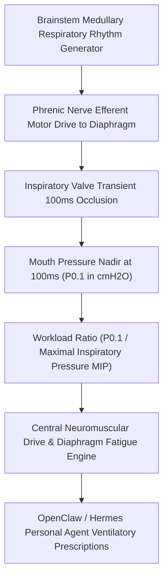

# Respiratory Mouth Occlusion Pressure (P0.1) Skill

[](LICENSE)
[](https://www.python.org/)
[](requirements.txt)
[](mcp_server.py)
[](SKILL.md)

Zero-dependency sovereign personal agent skill for non-invasive evaluation of Respiratory Mouth Occlusion Pressure at 100 ms (P0.1 in cmH2O), P0.1/MIP ratio, and central medullary drive.



## Features
- **Deterministic Math**: Pure Python standard library implementation with zero external dependencies.
- **Respiratory Physiology Standards**: Implements validated equations for 100ms mouth occlusion pressure and P0.1/MIP ratios.
- **Pure Central Neural Output**: Directly measures brainstem output unaffected by lung resistance, compliance, or conscious effort.
- **Model Context Protocol (MCP)**: Native JSON-RPC tool integration for LLMs and autonomous agents.

## Quickstart

```python
from client import RespiratoryMouthOcclusionDriveClient

client = RespiratoryMouthOcclusionDriveClient()
result = client.evaluate_p01_drive(
    p01_occlusion_pressure_cmh2o=1.75,
    maximal_inspiratory_pressure_cmh2o=95.0
)
print("P0.1 Pressure:", result["p01_occlusion_pressure_cmh2o"], "cmH2O")
print("Central Drive Score:", result["central_drive_score"])
print("Classification:", result["classification"])
```

## License
Apache-2.0
